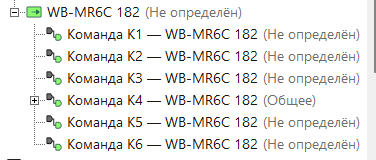
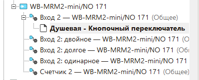

# wb-loxone — Wiren Board devices in Loxone

[Русская версия](README.md)

A bridge that runs right on a [Wiren Board](https://wirenboard.com) controller
and exposes its devices to a [Loxone](https://www.loxone.com) Miniserver:
relays, inputs, sensors, meters, Zigbee via zigbee2mqtt, wb-rules virtual
devices — anything the controller publishes to MQTT.

Channels are selected in the web UI. For Loxone Config the bridge assembles
ready-made virtual input and output templates, one per device. Button presses
(single, double, triple, long) are detected by the bridge itself and reach
Loxone as separate pulses.

```
 WB devices ──► MQTT ──► wb-loxone ──UDP──► Virtual UDP input   ┐
 (RS-485, Zigbee,         (on the WB)                           │ Loxone
  1-Wire, wb-rules) ◄────────────────◄──HTTP── Virtual output   └ Miniserver
```


* **States arrive immediately on change.** The bridge sends a UDP packet to
  Loxone as soon as a value changes in MQTT. Loxone does not poll anything.
* **Commands in milliseconds.** A Loxone virtual output calls HTTP on the
  controller, the bridge publishes the value to MQTT. A command takes the
  bridge single-digit milliseconds.
* **Per-device templates.** `VIU_<name>.xml` and `VO_<name>.xml`: a block in
  Loxone Config named after the device, lines like "channel — device".
* **Buttons.** The press count comes from the module's hardware pulse counter,
  so short presses are not lost even on a slow bus. Details —
  [docs/buttons.md](docs/buttons.md) (in Russian).
* **Nothing is installed on the controller.** One file on the standard
  Python 3.9 already present in the firmware. No pip, no Node-RED, no
  separate server.
* **Web UI in Russian and English** — language switcher in the header.

## How this differs from Modbus TCP (wb-mqtt-mbgate)

Wiren Board and Loxone can also be linked through the controller's Modbus
gateway, and many people do. The bridge does not replace it — it covers what
Modbus makes awkward:

| | Modbus TCP gateway | wb-loxone |
|---|---|---|
| States in Loxone | Loxone polls in a cycle | pushed immediately on change |
| Buttons | input state only; double/long press needs polling logic in Loxone | ready-made "single / double / triple / long" pulses |
| Templates | register addresses by hand | assembled automatically, per device |
| Zigbee, wb-rules, 1-Wire | register map configuration required | anything that exists in MQTT |
| Names | register numbers | channel and device names from WB |
| Text: modes, statuses, button actions | can't be sent | one digital input per value |

The two can be used together: outputs over Modbus, inputs and buttons over
the bridge.

## Install

On the Wiren Board controller, as root:

```bash
wget https://raw.githubusercontent.com/megavoltt/wb-loxone/main/install.sh
sh install.sh
```

You can open the downloaded `install.sh` and inspect it before running. If
`raw.githubusercontent.com` is unreachable from your network, use the CDN
mirror:

```bash
wget https://cdn.jsdelivr.net/gh/megavoltt/wb-loxone@main/install.sh
WBLOX_URL=https://cdn.jsdelivr.net/gh/megavoltt/wb-loxone@main sh install.sh
```

At the end the installer shows the web UI address — by default
`http://<controller IP>:8099`.

Re-running the same command updates the bridge. Settings and channel
selection are preserved.

Requirements: Wiren Board 7 or 8 with a current firmware (tested on wb-2602
and wb-2609: Debian 11–13, Python 3.9–3.13), Loxone Miniserver Gen1 or Gen2,
Loxone Config 16+.

## First five minutes

1. Open `http://<controller IP>:8099`, enter the **Miniserver IP** and press
   "Save".
2. Expand a device and tick the channels you need. The selection is saved
   immediately. Switches and buttons can be tested right from the page (⇆, ▶).
3. Optionally give the device a **Name in Loxone** — that is how the block
   and the template files will be named.
4. Download the templates: the **VIU / VO** buttons next to a device, or
   **"Templates for all devices (ZIP)"** at the top.
5. In Loxone Config: "Virtual Inputs" → "Import template" → `VIU_…xml`, then
   the same under "Virtual Outputs" → `VO_…xml`. Drag the inputs and outputs
   you need onto the program page and save to the Miniserver.

After import the blocks look like this — one block per device, lines like
"channel — device" (Loxone Config UI is shown in Russian; English screenshots
are coming):




More details, with wiring examples, in [docs/loxone.md](docs/loxone.md)
(in Russian).

## Documentation

* [docs/buttons.md](docs/buttons.md) — buttons: how presses are detected, settings, delays, debugging
* [docs/loxone.md](docs/loxone.md) — importing templates and wiring to Loxone blocks
* [docs/wirenboard.md](docs/wirenboard.md) — module input modes, Modbus events, RS-485 bus
* [docs/protocol.md](docs/protocol.md) — UDP and HTTP formats, settings file, web UI API
* [CHANGELOG.md](CHANGELOG.md) — what changed between versions

English translations of `docs/` are planned; contributions are welcome.

## Where things live on the controller

| Path | What it is |
|---|---|
| `/mnt/data/wb-loxone/` | code and web UI |
| `/mnt/data/etc/wb-loxone.json` | settings and selected channels |
| `/etc/systemd/system/wb-loxone.service` | systemd service |

`/mnt/data` survives firmware updates. After a full reflash (FIT) run the
installer once more — the settings will be picked up.

```bash
systemctl status wb-loxone          # service status
journalctl -u wb-loxone -f          # live log
```

Uninstall:

```bash
systemctl disable --now wb-loxone && rm -rf /etc/systemd/system/wb-loxone.service /mnt/data/wb-loxone /mnt/data/etc/wb-loxone.json
```

## Security

The bridge is designed for a local network.

* The web UI has no password by default — set one in the settings if there
  are untrusted devices on the network.
* Commands from Loxone are protected by a key in the URL (`/set/<key>/…`).
  The bridge executes commands only for channels selected in the UI, and
  only for channels with write enabled. A new key can be generated with a
  button; after that the VO templates must be imported again.
* Do not expose the bridge port to the internet.

## Translations

The web UI is available in Russian and English (switcher in the header).
Documentation translations are welcome — see the notes in
[README.md](README.md).

## License

[MIT](LICENSE) — free to use, including in commercial projects.
