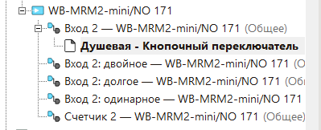

# Buttons: single, double, triple and long press

A button wired to an input of a Wiren Board module (WB-MR6C, WB-MRM2-mini,
WB-MCM8, WB-M1W2 and others) reaches Loxone as two kinds of channels:

| Channel in Loxone | What arrives | Use for |
|---|---|---|
| `Input 1` | `1` while the button is held; `0` after release | hold: dimming, blinds "while held" |
| `Input 1: single` | pulse `1 → 0` | on / off |
| `Input 1: double` | pulse | scene, "all off" |
| `Input 1: triple` | pulse | one more scene |
| `Input 1: long` | pulse, once per hold | a separate action for long press |

Event channels appear automatically for every input that has the
`Input N` + `Input N counter` pair in MQTT. Select and export them into the
template like regular channels.

> **Zigbee buttons and switches are a different case.** They don't use
> counters: zigbee2mqtt itself reports ready-made events as a text channel
> `action` (`1_single`, `2_double`, `1_long`…). The bridge forwards them as
> text, and in the template each value becomes a separate digital input. How
> to wire this and why the inputs don't appear right away — see
> [loxone.md](loxone.md#zigbee-buttons-and-switches-zigbee2mqtt).

The pulse lasts 150 ms (`pulse_ms`): first `1` arrives, then `0`. At the input
of a Loxone block it looks like a short button press.

## Why not just expose the raw input to Loxone

Loxone can distinguish double and long presses on a digital input by itself.
But to do that it needs to see every press and every release in time. With
RS-485 modules that is not the case.

The `wb-mqtt-serial` driver polls the devices on the bus in a round-robin
fashion. At 9600 baud with a dozen devices on the bus, one round takes
hundreds of milliseconds, sometimes a second. A short press lasts about
100–200 ms:

```
button        ▁▁▁▁█████▁▁▁▁█████▁▁▁▁▁▁▁▁▁▁▁▁▁▁▁▁▁▁▁▁▁▁   double press
bus polling   ▲                         ▲               ▲
input in MQTT 0                         0               0   ← both presses lost
```

The poll can land between the presses, and Loxone will see none of them. Or it
will see one — and count a double press as a single one.

## How the bridge counts presses

Every input of a WB module has a **hardware pulse counter**
(`Input N counter`). The module increments it by itself, on every press,
independently of polling. The counter doesn't lose presses: even if the poll
missed both pulses, it will show "+2".

```
button        ▁▁▁▁█████▁▁▁▁█████▁▁▁▁▁▁▁▁▁▁▁▁▁▁▁▁▁▁▁▁▁▁
counter       100  101       102
bus polling   ▲                         ▲
to MQTT       100                       102   ← +2 → double
```

The bridge uses two sources:

* **press count** — from the growth of the `Input N counter`;
* **hold** — from the state of the `Input N` channel. A hold lasts longer
  than one polling round, so the bus sees it.

The algorithm:

1. The counter grew — that many presses are added to the current series.
2. After each release the bridge waits `click_ms` (250 ms by default). Another
   press arrived — the series continues. Nothing arrived — an event is sent:
   1 press → "single", 2 → "double", 3 and more → "triple".
3. If the button is held longer than `long_ms` (600 ms), "long" is sent
   immediately, without waiting for the release, and this press no longer
   counts as a single one.
4. The `Input N` state is always forwarded as is — for dimming.

### Don't wait when there's no need to

The `click_ms` pause exists only to tell a single press from a double one. If
no longer series is needed, the bridge doesn't wait for it. Only the events
selected for Loxone are taken into account:

| Selected events | Single press sent | Double press sent |
|---|---|---|
| single | immediately on release | — |
| single + double | `click_ms` after release | immediately on the second press |
| single + double + triple | `click_ms` after release | `click_ms` after release |

Conclusion: don't select more than you need. If a button only does
"on/off" — select just "single", and there will be no waiting delay at all.

### Edge cases

| Situation | What the bridge does |
|---|---|
| The poll missed the press, only the counter growth arrived | the event is still sent |
| Both presses of a double arrived in one polling round (counter +2) | "double" |
| The counter arrived after a long press was already released | not counted as a single press |
| The input is closed when the service starts (wall switch, sensor) | not counted as a long press |
| The module rebooted, the counter started over | the growth is not counted |
| The counter grew by more than 20 at once | treated as garbage, skipped |

All these cases are covered by tests: `python -m unittest discover -s tests`.

## Settings

In the web UI, "Loxone connection" card:

| Setting | Default | What it changes |
|---|---|---|
| Next-click wait, ms (`click_ms`) | 250 | how long to wait for the next press of a series after release |
| Long press from, ms (`long_ms`) | 600 | from what duration a hold counts as a long press |

`pulse_ms` (150) and `button_log` (detailed log, off) are changed in the
settings file `/mnt/data/etc/wb-loxone.json`; after editing, run
`systemctl restart wb-loxone`.

### Choosing `click_ms`

It's a trade-off: the shorter the pause, the faster the single press, but the
more often a slow double press falls apart into two single ones.

A live measurement: between releasing and pressing again in a double press, a
person takes 150–200 ms. Hence the 250 ms default — with a small margin. If
someone in the house presses more slowly, set 300–350.

**The pause must be longer than the bus delay.** If the input is polled in a
round-robin cycle (mode 3, see below), the second press may arrive after the
pause has expired — and the double press falls apart. That is why buttons need
an input mode with events.

## Module input mode — it matters for speed

WB modules have a "Mode" parameter for every input. It affects not only
whether the input drives the relay directly, but also **how the driver learns
about the press**:

| Mode | Input drives the relay itself | How the driver learns about the press | Delay |
|---|---|---|---|
| 0 — Button, 1 — Switch… | yes | event from the module | single-digit to tens of ms |
| 3 — Control disabled | no | round-robin polling | up to one bus round, sometimes up to 1 s |
| 4 — By mapping matrix (matrix empty) | no | event from the module | single-digit to tens of ms |

If a button should work **only through Loxone**, set mode **4 with an empty
matrix**, not 3. The behaviour is the same — the input doesn't touch the
relay. But the driver enables events (Fast Modbus) for the input and learns
about the press immediately.

Measurement on WB-MRM2-mini: in mode 3 a double press reached Loxone with a
delay of up to a second; after switching to mode 4 — 1–30 ms after the second
press.

How to switch and how to check that events are enabled — see
[wirenboard.md](wirenboard.md#input-mode-and-events).

## Wiring in Loxone

A typical scheme for the "Lighting Controller" block:

| Bridge channel | Block input |
|---|---|
| `Input 1: single` | next scene / on-off |
| `Input 1: double` | scene (e.g. "All off" or "Bright") |
| `Input 1: long` | one more scene |
| `Input 1` (state) | dimming input, if hold is needed |

This is what it looks like in Loxone Config: the input state goes to a
"Push-button switch" block, and the double, long and single press events go to
separate lines of the same block:



Do not feed both `Input 1` and its events into one block: the block will start
counting presses from the input itself and the action will fire twice.

More details — in [loxone.md](loxone.md).

## Debugging

Every event is written to the log with milliseconds:

```bash
journalctl -u wb-loxone -f
```
```
21:36:13.456 Press: wb-mrm2-mini_171/Input 2#double
```

To see when the presses and the counter actually arrive, enable the detailed
log: set `"button_log": true` in `/mnt/data/etc/wb-loxone.json` and restart
the service. The log is written only for inputs with at least one event
selected:

```
21:37:01.760   input wb-mrm2-mini_171/Input 2: pressed
21:37:01.763   input wb-mrm2-mini_171/Input 2: counter 44 → 45
21:37:01.953   input wb-mrm2-mini_171/Input 2: released
21:37:02.386 Press: wb-mrm2-mini_171/Input 2#click
```

How to read it:

* **"pressed" arrives later than you actually pressed** — bus delay: the
  input is polled in a round-robin cycle. Check the input mode (you need 4,
  not 3).
* **a pause between "released" and "Press" is the `click_ms` wait** — it's
  waiting for a second press. Remove unneeded events from the input or
  shorten the pause.
* **"Press" is in the log but Loxone doesn't react** — check the Miniserver
  IP and UDP port in the settings, the sender address in the virtual input
  block, and that the template was imported after you selected this event.

After debugging, turn `button_log` off: on a busy system the log grows fast.
