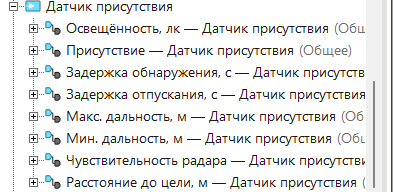
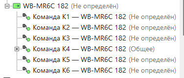
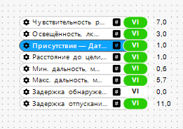

# Loxone Config: templates and wiring

## What templates are created

For every device with selected channels — up to two files:

| File | Block in Loxone Config | What's inside |
|---|---|---|
| `VIU_<name>.xml` | Virtual UDP input | all selected channels that can be read |
| `VO_<name>.xml` | Virtual output | all selected channels that can be written |

`<name>` is the "Name in Loxone" set in the web UI, or the device title in WB.
The block is named the same. Lines inside the block look like "channel — device",
e.g. `Input 1: double — WB-MR6C 77`.




You can download them per device (VIU / VO buttons) or all at once as an
archive ("Templates for all devices (ZIP)"). The "Common VIU / VO" buttons
assemble all selected channels of all devices into one block — for those who
are used to that.

## Import

**Option 1 — through Config.** Periphery → Virtual Inputs → "Virtual Inputs"
tab → "Import template" → choose `VIU_…xml`. Then the same for virtual outputs
and `VO_…xml`.

**Option 2 — through the templates folder.** Put the files into

```
Documents\Loxone\Loxone Config\Templates\VirtualIn\    (VIU_*)
Documents\Loxone\Loxone Config\Templates\VirtualOut\   (VO_*)
```

and after restarting Config they will appear in the template list when adding
a virtual input or output.

After import, drag the inputs and outputs you need onto the program page and
save the project to the Miniserver. On the program page the inputs show live
values from WB:



**Added channels — import the template again.** Loxone Config doesn't update
an already created block by itself.

## What's inside a template

UDP input:

```xml
<VirtualInUdp Title="WB-MR6C 77" Address="192.168.1.50" Port="7001">
  <VirtualInUdpCmd Title="Input 1: double — WB-MR6C 77"
                   Check="wb.wb-mr6c_77.Input_1_double=\v" Analog="true" .../>
```

* `Address` — the WB controller's IP. Loxone only accepts packets from it, so
  foreign packets on the same port don't get mixed in.
* `Port` — the UDP port shared by all bridge blocks (7001 by default).
  Several blocks on one port is normal.
* All inputs are analog: relays and buttons arrive as `0`/`1`. An analog
  input carrying `0`/`1` can be wired to digital inputs of blocks.

HTTP output:

```xml
<VirtualOut Title="WB-MR6C 77" Address="http://192.168.1.50:8099">
  <VirtualOutCmd Title="K1 — WB-MR6C 77"
                 CmdOn="/set/<key>/wb-mr6c_77/K1/1" CmdOff="/set/<key>/wb-mr6c_77/K1/0"/>
  <VirtualOutCmd Title="Brightness — WB-MDM3 12" Analog="true"
                 CmdOn="/set/<key>/wb-mdm3_12/Channel%201/&lt;v&gt;"/>
```

* Relays, switches, pushbuttons (`switch`, `pushbutton`) — digital outputs with
  on and off commands.
* Dimmers, setpoints, `range` — analog outputs, Loxone substitutes the value
  for `<v>`. The bridge clamps the value to the channel's `min`/`max`.
* RGB — Loxone sends the colour in its own format (`BBBGGGRRR` in percent);
  the bridge converts it to `R;G;B` for WB.

## Wiring examples

**Relay with feedback.** Output `K1 — WB-MR6C 77` — to the output of a block
("Lighting", "Switch"). Input `K1 — WB-MR6C 77` — the relay state, if you need
to see the actual state (for example, when the relay is also toggled locally).

**Button to a "Lighting" block.**

| Channel | Block input |
|---|---|
| `Input 1: single` | on / off or next scene |
| `Input 1: double` | the scene you want |
| `Input 1: long` | one more scene |
| `Input 1` | dimming by hold, if needed |

Do not wire both the `Input 1` state and its events to one block: the block
will count presses from the input itself and the action will fire twice.
Details on buttons — in [buttons.en.md](buttons.en.md).

**Zigbee buttons and switches (zigbee2mqtt).** Zigbee devices reach MQTT via
zigbee2mqtt, and presses show up as a text channel `action` with values like
`1_single`, `1_double`, `1_long`. The bridge forwards it to UDP as text, and
in the template such a channel expands into digital inputs — one for every
known value:

| Bridge channel | Block input |
|---|---|
| `action=1_single` | on / off or next scene |
| `action=1_double` | the scene you want |
| `action=1_long` | one more scene |

Unlike buttons on WB modules (see [buttons.en.md](buttons.en.md)), the events
are produced by zigbee2mqtt itself — there are no hardware counters and no
`click_ms`/`long_ms` settings here, and no presses are lost.

Two rules, without which "it doesn't reach Loxone":

1. **A template input appears only for values that have already happened.**
   The bridge remembers every new value and writes to the log:
   `text: …/action = 1_single (a new input will appear in the template)`. If
   you download the template before the buttons were ever pressed, the inputs
   you need won't be there.
2. **A new value appeared — recreate and re-import the template.** Loxone
   Config doesn't add inputs to an existing block by itself.

Practical order: press all the buttons and combinations you plan to use (in
`journalctl -u wb-loxone -f` these are the "text: …" lines), then download the
template and import it. The list of already known values is visible in the web
UI under the text channel; it's also stored in the config (`textvals`).

**Sensors and meters.** Temperature, humidity, power, energy — analog inputs
with units and precision from the WB channel description. To avoid overloading
the Miniserver, set "Min interval, ms" in the bridge to 1000–5000 for fast
changing values (power, current).

## After the Miniserver reboots

The bridge re-sends all selected values every 300 seconds (`resync_s`), so
after a Miniserver reboot the states recover by themselves. To get them
immediately — press "Resend values" in the web UI.
