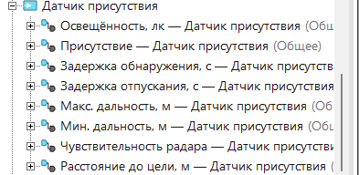
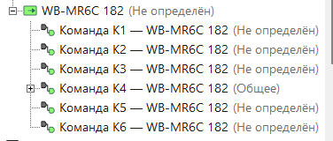
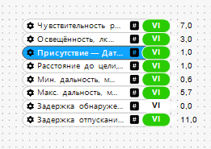

# Loxone Config: шаблоны и подключение

## Какие шаблоны создаются

На каждое устройство с выбранными каналами — до двух файлов:

| Файл | Блок в Loxone Config | Что внутри |
|---|---|---|
| `VIU_<имя>.xml` | Виртуальный вход UDP | все выбранные каналы, которые можно читать |
| `VO_<имя>.xml` | Виртуальный выход | все выбранные каналы, в которые можно писать |

`<имя>` — «имя в Loxone», заданное в интерфейсе, или название устройства в WB.
Так же называется и сам блок. Строки внутри блока — «канал — устройство»,
например `Вход 1: двойное — WB-MR6C 77`.




Скачать можно у каждого устройства (кнопки VIU / VO) или все разом архивом
(«Шаблоны всех устройств (ZIP)»). Кнопки «Общий VIU / VO» собирают все выбранные
каналы всех устройств в один блок — для тех, кто так привык.

## Импорт

**Вариант 1 — через Config.** Периферия → Виртуальные входы → вкладка
«Виртуальные входы» → «Импорт шаблона» → выбрать `VIU_…xml`. Затем то же для
виртуальных выходов и `VO_…xml`.

**Вариант 2 — через папку шаблонов.** Положить файлы в

```
Документы\Loxone\Loxone Config\Templates\VirtualIn\    (VIU_*)
Документы\Loxone\Loxone Config\Templates\VirtualOut\   (VO_*)
```

и после перезапуска Config они появятся в списке шаблонов при добавлении
виртуального входа или выхода.

После импорта перетащите нужные входы и выходы на страницу программы и
сохраните проект в Miniserver. На странице программы входы показывают живые
значения от WB:



**Добавили каналы — импортируйте шаблон заново.** Loxone Config не обновляет
уже созданный блок сам.

## Что внутри шаблона

Вход UDP:

```xml
<VirtualInUdp Title="WB-MR6C 77" Address="192.168.1.50" Port="7001">
  <VirtualInUdpCmd Title="Вход 1: двойное — WB-MR6C 77"
                   Check="wb.wb-mr6c_77.Input_1_double=\v" Analog="true" .../>
```

* `Address` — IP контроллера WB. Loxone принимает пакеты только от него, поэтому
  чужие пакеты на тот же порт не путаются.
* `Port` — порт UDP, общий для всех блоков моста (по умолчанию 7001). Несколько
  блоков на одном порту — это нормально.
* Все входы аналоговые: реле и кнопки приходят как `0`/`1`. Аналоговый вход
  с `0`/`1` можно подключать к цифровым входам блоков.

Выход HTTP:

```xml
<VirtualOut Title="WB-MR6C 77" Address="http://192.168.1.50:8099">
  <VirtualOutCmd Title="K1 — WB-MR6C 77"
                 CmdOn="/set/<ключ>/wb-mr6c_77/K1/1" CmdOff="/set/<ключ>/wb-mr6c_77/K1/0"/>
  <VirtualOutCmd Title="Яркость — WB-MDM3 12" Analog="true"
                 CmdOn="/set/<ключ>/wb-mdm3_12/Channel%201/&lt;v&gt;"/>
```

* Реле, переключатели, кнопки (`switch`, `pushbutton`) — цифровые выходы, команды
  включения и выключения.
* Диммеры, уставки, `range` — аналоговые выходы, Loxone подставляет значение
  вместо `<v>`. Мост ограничивает значение диапазоном `min`/`max` канала.
* RGB — Loxone шлёт цвет в своём формате (`BBBGGGRRR` в процентах), мост
  переводит его в `R;G;B` для WB.

## Примеры подключения

**Реле с обратной связью.** Выход `K1 — WB-MR6C 77` — на выход блока
(«Освещение», «Выключатель»). Вход `K1 — WB-MR6C 77` — состояние реле, если
нужно видеть фактическое состояние (например, если реле переключают ещё и
локально).

**Кнопка на блок «Освещение».**

| Канал | Вход блока |
|---|---|
| `Вход 1: одинарное` | вкл / выкл или следующая сцена |
| `Вход 1: двойное` | нужная сцена |
| `Вход 1: долгое` | ещё одна сцена |
| `Вход 1` | диммирование удержанием, если нужно |

Не подключайте к одному блоку одновременно состояние `Вход 1` и события:
блок сам посчитает нажатия по входу, и действие выполнится дважды. Подробно о
кнопках — в [buttons.md](buttons.md).

**Zigbee-кнопки и выключатели (zigbee2mqtt).** Zigbee-устройства приходят в MQTT
через zigbee2mqtt, и нажатия видны как текстовый канал `action` со значениями
`1_single`, `1_double`, `1_long` и т.п. Мост отправляет его в UDP как текст, а
в шаблоне такой канал разворачивается в цифровые входы — по одному на каждое
известное значение:

| Канал моста | Вход блока |
|---|---|
| `action=1_single` | вкл / выкл или следующая сцена |
| `action=1_double` | нужная сцена |
| `action=1_long` | ещё одна сцена |

В отличие от кнопок на модулях WB (см. [buttons.md](buttons.md)), события
готовит сам zigbee2mqtt — аппаратных счётчиков и настроек `click_ms`/`long_ms`
здесь нет, нажатия не теряются.

Два правила, без которых «не приходит в Loxone»:

1. **Вход в шаблоне появляется только для значений, которые уже случились.**
   Мост запоминает каждое новое значение и пишет в журнал
   `текст: …/action = 1_single (в шаблоне появится новый вход)`. Если скачать
   шаблон до того, как кнопки нажимали, нужных входов в нём не будет.
2. **Появилось новое значение — пересоздайте и импортируйте шаблон заново.**
   Loxone Config не добавляет входы в уже созданный блок сам.

Практичный порядок: нажмите все кнопки и комбинации, которые планируете
использовать (в `journalctl -u wb-loxone -f` это строки «текст: …»), затем
скачайте шаблон и импортируйте. Список уже известных значений виден в
веб-интерфейсе под текстовым каналом; он же хранится в конфиге (`textvals`).

**Датчики и счётчики.** Температура, влажность, мощность, энергия — аналоговые
входы с единицами измерения и точностью из описания канала WB. Чтобы не
перегружать Miniserver, для быстро меняющихся значений (мощность, ток)
поставьте в мосте «Не чаще, мс» 1000–5000.

## После перезагрузки Miniserver

Мост раз в 300 секунд пересылает все выбранные значения (`resync_s`), так что
после перезагрузки Miniserver состояния восстановятся сами. Сразу — кнопкой
«Переслать значения» в интерфейсе.
